<p align="center"></p>

<p align="center">


</p>

<p align="center">
<b><a href="https://github.com/Mulaydm10/yas-camloc/blob/main/submissions/slides.pdf">Slides</a></b> &nbsp;·&nbsp;
<b><a href="https://drive.google.com/file/d/1IMbsoWdDjTM87MPVoOgOlCoiCfW6adw9/view?usp=sharing">Video (4:39)</a></b> &nbsp;·&nbsp;
<b><a href="https://drive.google.com/file/d/1VIL1U20j1YQYrW2CmlARg6J6YRSCXCMO/view?usp=sharing">Trajectory vs GT</a></b> &nbsp;·&nbsp;
<b><a href="https://github.com/Mulaydm10/yas-camloc/blob/main/submissions/validation/pooled.txt">Validation scores</a></b> &nbsp;·&nbsp;
<b><a href="#submission">Submission</a></b>
</p>

<p align="center"><b>Team Rogue Ravens</b>: Tamo Schäfers · Dhruv Mulay · Gagan Karthik Sripuram · Taa-seen Ahmed</p>

Constructor Labs challenge, National AI Hackathon 2026. A causal localiser estimates the race car's 2D pose
(`x, y, yaw` of `constructor0/base_link` in `map`) at camera rate from its 7 cameras. It runs on CPU in real time.

---

## 🏁 See it drive

<p align="center">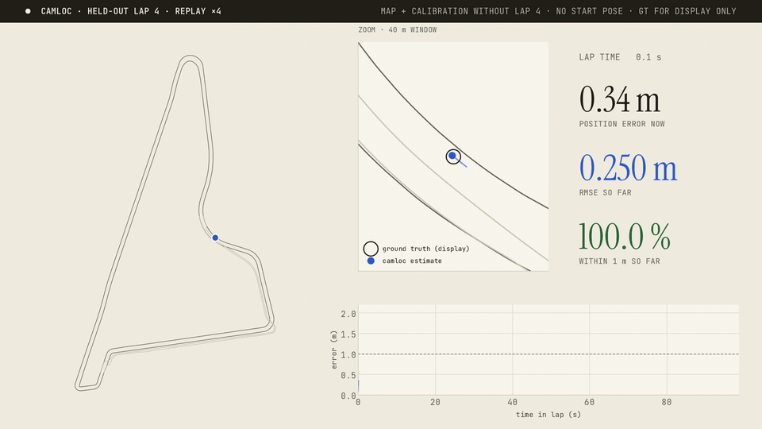</p>

<p align="center"><i>Held-out lap 4 at ×4 speed. The map and every calibration were rebuilt <b>without</b> this lap, and no start pose was given.
The trail is coloured by position error; ground truth is drawn for display only.</i></p>

| | position RMSE | lateral RMSE | heading RMSE | within 1 m | coverage | time / frame |
|:-|:-:|:-:|:-:|:-:|:-:|:-:|
| **strict held-out laps 2 / 4 / 6, pooled** | **0.513 m** | **0.303 m** | **0.31°** | **95.1 %** | 99.8 % | **~22 ms** (M4 CPU) |

<i>Scope: night training run, each lap held out in turn. These are validation numbers, not a hidden-test result.</i>

## 🧭 The idea: a rally co-driver with a pace-note book

<p align="center">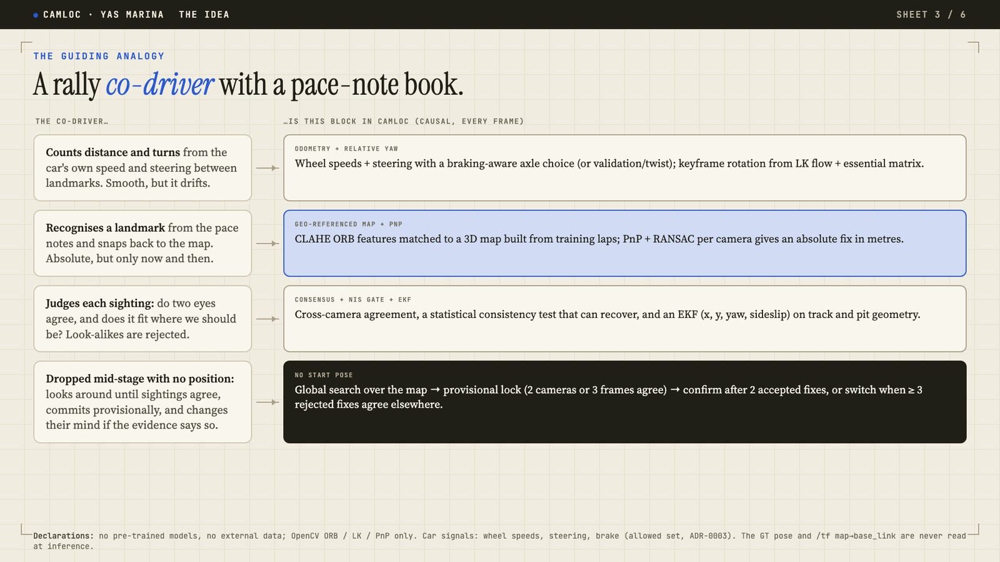</p>

| The co-driver… | …is this block in camloc |
|:-|:-|
| 🧮 counts distance and turns from speed and steering (smooth, but it drifts) | wheel/twist **odometry** + keyframe **relative yaw** |
| 📍 recognises a landmark and snaps back to the map | **geo-referenced ORB map** + **PnP/RANSAC** per camera |
| 🧠 judges each sighting and rejects look-alikes | **cross-camera consensus** + **NIS gate** + **EKF** with online sideslip |
| 🔄 dropped mid-stage: looks around, commits provisionally, changes its mind | **global search → provisional lock → confirm / switch** |

## 🔄 No start pose? It finds itself, and fixes its own mistakes

<p align="center">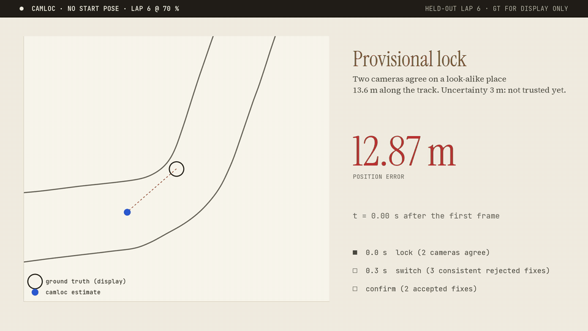</p>

<p align="center"><i>Started at 70 % of held-out lap 6 with no pose. Two cameras agree on a look-alike place 13.6 m away (provisional lock);
within 0.3 s three rejected fixes agree elsewhere and the filter switches; two accepted fixes confirm. <b>16 / 16</b> mid-lap starts end correct.</i></p>

<table>
<tr>
<td width="50%">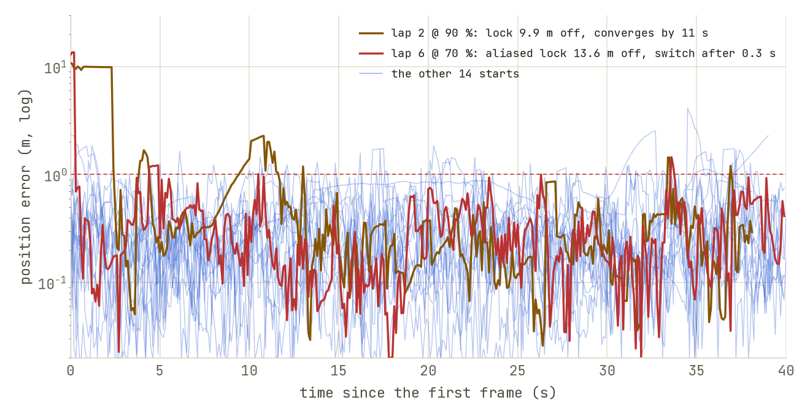<br><i>16 mid-lap starts: lock within 1.8 s, every one ends correct.</i></td>
<td width="50%">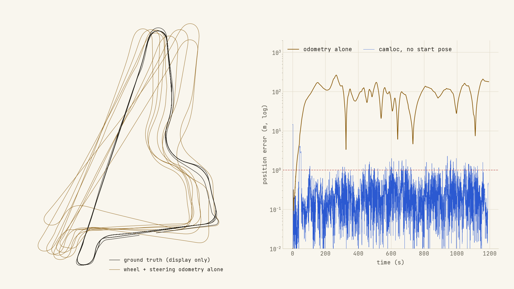<br><i>Why the map matters: odometry alone drifts to 107 m RMSE, even from the true start.</i></td>
</tr>
<tr>
<td>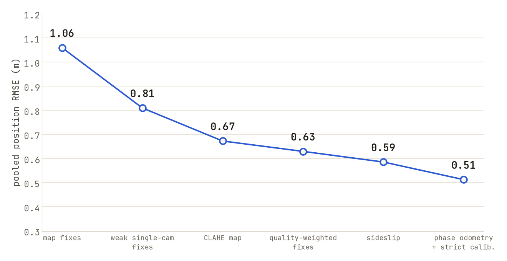<br><i>Every step was kept only if held-out error fell: 1.06 → 0.51 m.</i></td>
<td>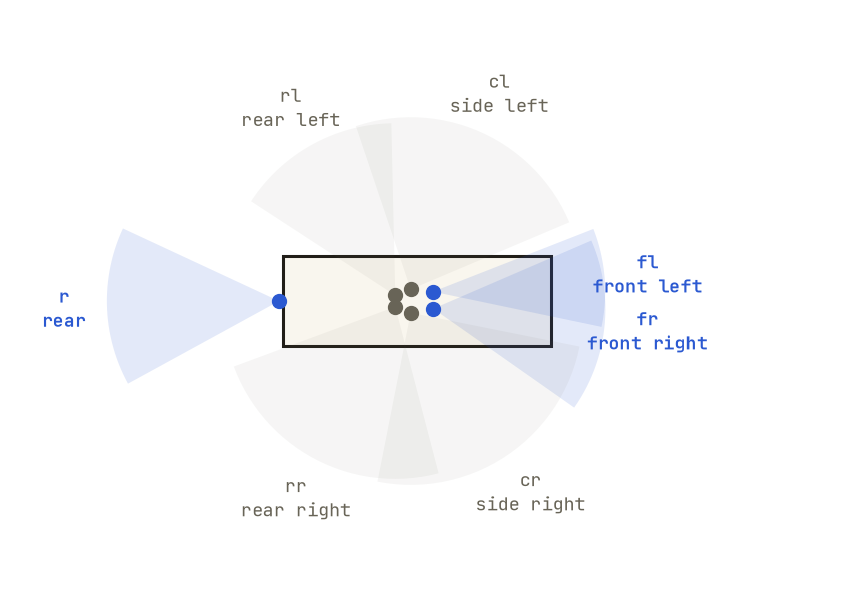<br><i>The rig: 7 cameras; front-left, front-right and rear carry the map fixes.</i></td>
</tr>
</table>

## 🖥️ One command

```bash
./run.sh test.mcap out.csv            # no flags, both topic layouts, builds the venv + visual map on first use
```

<details>
<summary><b>▶ Watch a live held-out run + the official scorer</b></summary>
<p align="center">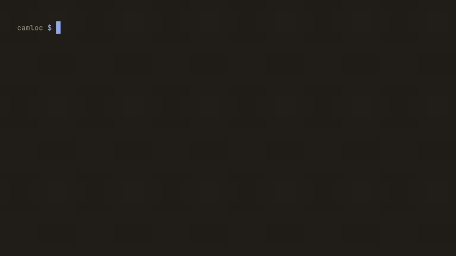</p>
</details>

<details>
<summary><b>📑 Slide gallery</b> (methodology, results, failure cases and lessons)</summary>

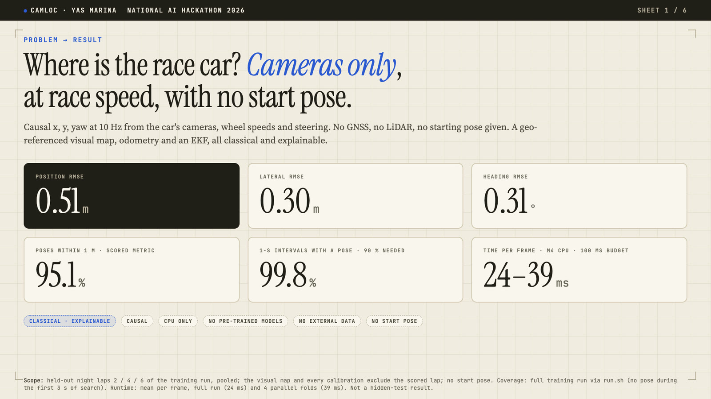
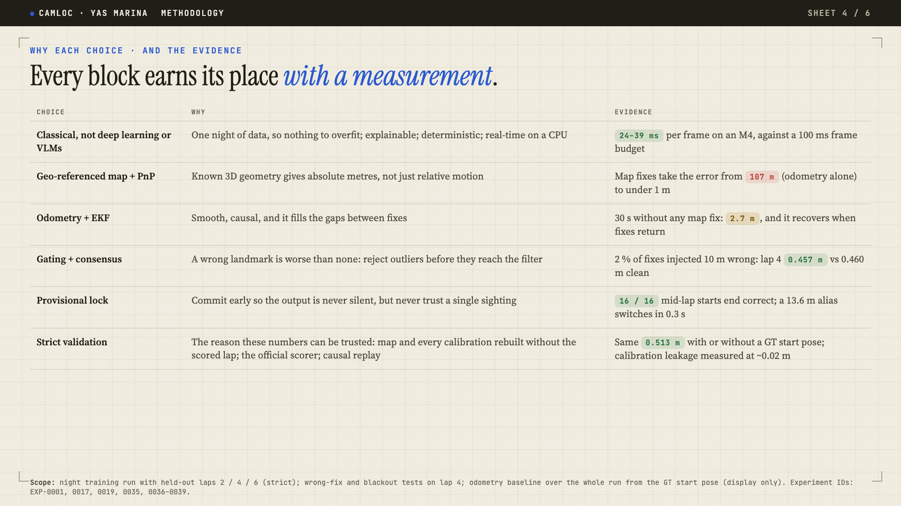
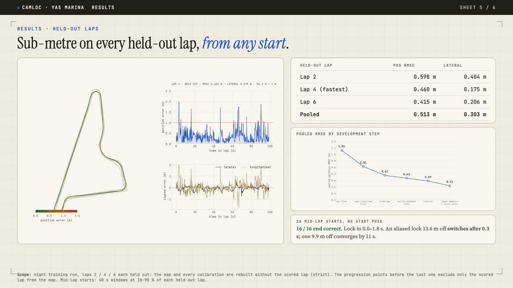
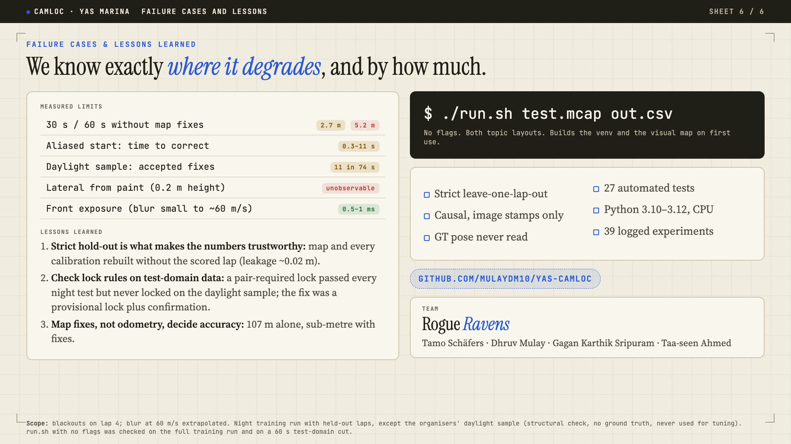
</details>

**More:** full analysis in `REPORT.md`, experiment history in `experiments/experiment_log.md`, results tables in [Results](#results).

---

## Submission

| Form item | File |
|---|---|
| Hidden-test pose CSV | produced by `./run.sh test.mcap out.csv` (format below) |
| Validation pose CSVs (strict held-out laps) | [lap 2](https://github.com/Mulaydm10/yas-camloc/blob/main/submissions/poses/heldout_lap2_strict.csv), [lap 4](https://github.com/Mulaydm10/yas-camloc/blob/main/submissions/poses/heldout_lap4_strict.csv), [lap 6](https://github.com/Mulaydm10/yas-camloc/blob/main/submissions/poses/heldout_lap6_strict.csv) |
| Validation results (official scorer output) | [lap 2](https://github.com/Mulaydm10/yas-camloc/blob/main/submissions/validation/lap2_scores.txt), [lap 4](https://github.com/Mulaydm10/yas-camloc/blob/main/submissions/validation/lap4_scores.txt), [lap 6](https://github.com/Mulaydm10/yas-camloc/blob/main/submissions/validation/lap6_scores.txt), [pooled](https://github.com/Mulaydm10/yas-camloc/blob/main/submissions/validation/pooled.txt): 0.513 m position, 0.303 m lateral, 95.1 % within 1 m |
| Trajectory vs GT on a validation lap | [plot](https://github.com/Mulaydm10/yas-camloc/blob/main/submissions/trajectory_lap4.png), [replay video](https://github.com/Mulaydm10/yas-camloc/blob/main/submissions/trajectory_lap4.mp4) (held-out lap 4, GT drawn for display only); **play in browser: [Google Drive](https://drive.google.com/file/d/1VIL1U20j1YQYrW2CmlARg6J6YRSCXCMO/view?usp=sharing)** |
| Presentation | [slides.pdf](https://github.com/Mulaydm10/yas-camloc/blob/main/submissions/slides.pdf) (6 slides), [demo.mp4](https://github.com/Mulaydm10/yas-camloc/blob/main/submissions/demo.mp4) (4:39; **play in browser: [Google Drive](https://drive.google.com/file/d/1IMbsoWdDjTM87MPVoOgOlCoiCfW6adw9/view?usp=sharing)**), slides backup on [Drive](https://drive.google.com/file/d/16VywVtD-G7eKxUUWER8Kza64q30OdWA4/view?usp=sharing), [script](https://github.com/Mulaydm10/yas-camloc/blob/main/submissions/demo_script.md) |
| Source + run script | this repository, [`run.sh`](https://github.com/Mulaydm10/yas-camloc/blob/main/run.sh) |

**Pose CSV format.** `timestamp_ns,x,y,yaw,confidence,status`, one row per camera frame. `timestamp_ns` is the image header
stamp in ns (the organisers' `tools/evaluate.py` requires this column name, so we keep ns). x, y are in m and yaw is in rad,
for `constructor0/base_link` in the track (`map`) frame. `status` is `lost` for the best-hypothesis poses emitted before the
global-initialisation lock (32 rows, the first ~3 s of a run), otherwise `ok`. `confidence` = exp(−σ_pos / 1 m), where
σ_pos = √(P_xx + P_yy) is the EKF position standard deviation (0 while `lost`). Both columns are computed after the estimate
and never feed back into it. The official scorer reads the six-column file unchanged, with identical scores.

**No learned weights.** Nothing is trained by gradient descent and there are no model files. The only training-derived
artefacts are the calibrations in `camloc/assets/` (committed) and the visual map, which is derived from the dataset and
therefore not committed (licence). `run.sh` rebuilds it from the training bag on first use (about 1.6 min on an Apple M4, 4440 keyframes; the rebuilt map is byte-identical to ours).
The jury points `run.sh` at its copy of the training bag with the third argument:
`./run.sh test.mcap out.csv /path/to/c0_2026-10-13_22-53-42_camloc_0.mcap`.

**Confirmed:** no future frames (causal, image stamps only), and no ground truth at inference (the GT pose and
`/tf map->base_link` are never read; `tests/test_smoke.py` fails if inference code imports the GT or scoring modules).

## Run it

```bash
./run.sh <test.mcap | test_dir> <out.csv> [training.mcap] [-- extra camloc.run options]
```

- `run.sh` creates the Python 3.12 venv from `requirements.txt` if missing.
- It builds the training-derived visual map if missing. That needs the training bag; the map is derived from
  the dataset, so it is not committed.
- It then writes `out.csv` (`timestamp_ns,x,y,yaw,confidence,status`; see "Submission" below) and `out.run.json`, which holds the per-frame processing
  time and the hardware.
- **No starting pose is needed (or read).** The localiser finds its own first pose by matching the cameras
  against the whole visual map (global initialisation: a provisional lock from two cameras agreeing in one frame
  or three odometry-consistent frames, confirmed by the next map fixes or switched to a consistent alternative;
  time-boxed search; a pose is emitted from 3 s at the latest), and
  re-localises the same way after more than 15 s without a map fix. `/tf` `map->base_link` is never read at
  inference (`--gt-init` exists for validation only).
- **Input layouts:** the training layout (`state_estimation`, `track_bounds`), or the organisers'
  test-domain layout (no `state_estimation`, `/tf` or `track_bounds`). For the latter, speed, lateral velocity
  and yaw rate come from `/constructor0/validation/twist`, and the borders come from
  `camloc/assets/track_bounds.npz`, which `run.sh` exports from the training bag.
- The fused car-state variant (ADR-0003, not the default) runs with
  `./run.sh test.mcap out.csv -- --estimator vismap_est --state ambiguous`.

## Method (all causal: the pose at t uses only data stamped ≤ t)

```
 wheel speeds + steering ──► odometry (anti-slip axle choice, bicycle + understeer + steering lag)
                                   │ predict
 fl / fr / r images ──► keyframe rotation (LK + essential matrix) ──► relative-yaw update ─┐
                   └──► ORB vs geo-referenced 3D map ──► PnP + RANSAC ──► absolute pose fix ─┼─► EKF [x, y, yaw, yaw_kf]
 track borders (map) ──► lane model: track / pit lane, speed-gated switching; ────────────────┘
                         heading + lateral priors on straights when no map fix for > 2 s
```

1. **Odometry from allowed car signals only.**
   - Wheel speeds and steering, with parameters fitted on the training run (`tools/calibrate_odometry.py`).
   - The fused `state_estimation` speed and yaw-rate fields are **not used** by default. Their status is an
     open rules question; see `REPORT.md` §5.
2. **Visual heading.**
   - The rotation since a keyframe at most 1.5 s old is measured in `fl`, `fr` and `r` and fused through a
     cloned heading state.
   - Per-camera rotation scale (`fr` under-reports by 7.5 %), with a two-camera consensus.
3. **Map-based absolute fixes** (images contrast-normalised with CLAHE at build and query time).
   - At training time, ORB features are triangulated with the GT camera poses into a 3D map
     (`tools/build_map.py`).
   - At run time, per-camera PnP + RANSAC, gated by cross-camera consensus and an NIS test that can recover
     if the filter itself is wrong.
4. **Global initialisation and re-localisation** (no starting pose is given).
   - Every keyframe of the whole map is searched with descriptor votes, then PnP is run on the best
     candidates.
   - A *provisional* lock with an honest 3 m uncertainty comes from two cameras agreeing in one frame, or from
     the best hypotheses of 3 consecutive frames agreeing after odometry propagation. The time-boxed search then
     falls back to a relaxed lock at 6 s and to the best-supported hypothesis at 10 s.
   - Two accepted map fixes confirm the lock. It is revoked only on positive evidence: at least 3 rejected fixes
     that agree with each other on a pose at least 5 m away. The filter then switches to that pose. Scattered
     rejections, such as noisy daylight matches, never revoke.
   - On 16 held-out mid-lap starts it locks in 0.0–8.0 s, and all 16 end correct. The one aliased lock
     (13.6 m off) switches to the right pose after 0.3 s (EXP-0036..0039). Strict lap scores are identical to
     starting from the true pose.
5. **Track model.**
   - The surveyed borders give the track and pit-lane centrelines, with (s, n) projection that respects heading.
   - Lane membership is tracked and switches at the pit branch points only when the car is slow, at pit speed.
   - The 3D borders give the road z, roll and pitch.
6. **Camera self-calibration.**
   - Rotation corrections of 1° or less per camera, fitted on training GT (`tools/calibrate_cameras.py`).
   - Ego-body masks are hand-drawn polygons (`camloc/assets/body_polygons.json`).

**Declarations** (brief, "Minimal requirements"):
- Pre-trained models: **none**. External or public datasets: **none**.
- Sensors used at inference: the camera images (`fl`, `fr`, `r`), camera calibration and track borders.
- Car-state fields used at inference (allowed signals only, ADR-0003): wheel speeds `omega_w_*`, steering
  `delta_wheel_rad`, brake pressure `brake` (to choose the axle under braking) and
  `valid_wheelsspeeds_b`. In the test-domain layout, `/constructor0/validation/twist` supplies speed and yaw
  rate instead. The fused `state_estimation` speed and yaw rate are **not**
  used by the default. Pose fields and anything derived from the pose (`x/y/z`, attitude, `sn_map_state`)
  are never read.
- The training run's GT is used only at training time (odometry, camera and road calibration, the visual
  map) and for scoring. No starting pose is read: the localiser initialises itself (`--gt-init` exists for
  validation only). The test
`tests/test_smoke.py::test_inference_modules_do_not_import_groundtruth` enforces that inference code never
imports the GT modules.

## Results

All numbers come from the training run with a **strict hold-out**: for each lap the visual map **and** the
odometry calibration are rebuilt **without that lap**, the localiser runs causally over the whole recording using only the allowed car signals,
and only the held-out lap is scored with the official metric (`camloc/evaluate.py`, which reproduces the
organiser's `tools/evaluate.py`).

| held-out lap | position RMSE | lateral | longitudinal | heading RMSE | p95 | within 1 m |
|---|---|---|---|---|---|---|
| 2 | 0.598 m | 0.404 m | 0.440 m | 0.40° | 1.09 m | 93.2 % |
| 4 | 0.460 m | 0.175 m | 0.426 m | 0.21° | 0.91 m | 96.7 % |
| 6 | 0.415 m | 0.206 m | 0.361 m | 0.19° | 0.86 m | 96.6 % |
| **pooled (3 laps)** | **0.513 m** | **0.303 m** | | **0.31°** | | **95.1 %** |

The organiser scoring-script output for each lap is in `submissions/validation/`.

- **Calibration leakage.** With the odometry fitted on the full run instead, the same pipeline scores
  0.509 m pooled. An earlier check refitted every calibration (camera rotations and rotation scales too)
  without lap 4 and found about 0.02 m of leakage (`tools/holdout.py`).
- **Fused car-state variant** (ADR-0003; measured before the sideslip default): pooled 0.639 m, lateral 0.430 m, 87.2 % within 1 m.


- **Pit lane:** 1.09 m (whole run, map without lap 6).
- **Organiser (s, n) scorer:** agrees with the x/y numbers within 1 %. GT (s, n) is re-projected onto
  `map.mcap`, because the training bag's `sn_map_state` does not match it (`REPORT.md` §11).
- **Speed:** 21.6 ms per frame mean, 29.8 ms p95, on an Apple M4 CPU, no GPU (input at 10 Hz, budget 100 ms). Measured
  2026-10-18 on a fresh clone of this public repo (`./run.sh`, 60 s window, final estimator); the full 20-minute run
  averages about 24 ms, and 35-39 ms when four runs share the CPU. `out.run.json` records it with the hardware.

How we got here (whole run, allowed signals only; `experiments/experiment_log.md`):

| step | position RMSE |
|---|---|
| hold first pose | 528 m |
| + wheel / steering odometry | 144 m |
| + map priors on straights | 55.1 m |
| + visual heading | 21.5 m |
| + map-based PnP fixes | ≈1 m |
| + NIS gate, pit lane in map, lower single-camera threshold | 0.81 m held out |
| + contrast-normalised (CLAHE) map | 0.78 m held out |
| + single-camera threshold back to 30 with CLAHE, fix-quality weighting | 0.630 m held out |
| + sideslip (half gain) in the motion model | 0.586 m held out |
| + online sideslip states, phase-based axle choice (strict hold-out) | **0.513 m held out** |

### Robustness (the test may differ from the night training run)

**Image changes.** Query images were altered on held-out lap 4 (`tools/vmap_check.py --aug`); the map is
built from the unchanged night images. Columns give the `fr` map-localisation success rate:

| query images | plain ORB map | CLAHE-normalised map (default) |
|---|---|---|
| unchanged | 60 % | 82 % |
| darker (gamma 2) | 42 % | 72 % |
| contrast halved | 22 % | 66 % |
| washed out ("day": gamma 0.4, contrast 0.6) | 20 % | 60 % |
| 9 px motion blur | 11 % | 43 % |

When a fix succeeds it stays accurate: median 0.4–0.5 m in every case.

Spatial changes, which CLAHE cannot undo (TASK G, CLAHE map, success rate per camera fl / fr / r):

| query images | fl | fr | r |
|---|---|---|---|
| unchanged | 33 % | 82 % | 52 % |
| saturated sky (top 25 % white) | 33 % | 76 % | 44 % |
| cast shadow band | 20 % | 64 % | 36 % |
| floodlight glare (3 blobs) | 15 % | 34 % | 20 % |
| "blur for 30 m/s" (V/3 px model: worst case, unphysical, 13–25× too strong) | 11 % | 37 % | 13 % |
| "blur for 45 m/s" (same, worst case) | 0 % | 7 % | 1 % |
| "blur for 60 m/s" (same, worst case) | 0 % | 0.5 % | 0 % |

- The blur is added on top of the blur already in the night images, so it is pessimistic.
- **Measured afterwards (EXP-0030, EXP-0031):** the real images show no measurable blur growth with speed.
  A physical flow-field blur model (exposure × image motion from speed, yaw rate, camera geometry and
  ground-plane depth) fitted to the real sharpness gives an exposure of **about 0.5–1 ms for the front
  cameras**. That is an extrapolation from night data; daylight auto-exposure is normally shorter. At 60 m/s
  this predicts under 10 % sharpness loss, so the "V/3 px" rows above are an unphysical worst case.
- The open risk is therefore **not** speed blur but **anything that removes map fixes** (local glare halves
  them). The fallback then gives 2–5 m (blackout table above).
- In the full pipeline, floodlight glare on every image costs lap 4 0.46 → 1.12 m (EXP-0034). None of the
  fallback options tried (gated reset, corner bounds, wheel-scale state, DCS soft gate, LK map-point tracking)
  beat the default on the strict held-out laps (EXP-0032..0034), so all stay off.

**Losing map fixes.** These are switches for testing only (`--set FIX_DROP=…` / `FIX_GAP_S=… FIX_PERIOD_S=…`):

| map fixes | lap 4 | whole run |
|---|---|---|
| all (final default) | 0.61 m | 0.81 m |
| 50 % dropped at random (earlier default) | 0.70 m | 0.97 m |
| 90 % dropped at random (earlier default) | 0.88 m | 2.34 m |
| none for 30 s of every 60 s (final default) | 2.32 m | 2.90 m |
| none for 60 s of every 120 s (final default) | 2.95 m | 4.73 m |

The filter recovers as soon as fixes return. Only a total, permanent map failure would fall back to the
visual-heading-only result (21.5 m).

**Known failure cases and limits**:
- **Back straight** (around x ≈ −300, y ≈ 0–250): feature-poor at night. With the plain map, lap 2 drifted
  2–5 m sideways there. The CLAHE map with the final settings removes that drift (`docs/traj_lap2_heldout.png`).
- **Sideslip.** The car's travel direction leads its heading by roughly 0.23° + 0.14° per m/s² of lateral
  acceleration. Ignoring it biased the estimate about 0.2 m outward, mostly in left turns. The EKF now learns
  two sideslip terms online from the map fixes (EXP-0026), with no GT-fitted gain.
- **Locked front wheels under hard braking.** The front wheels can lock while the car is still at 20 m/s. An
  odometry that trusted the front axle then ran away by 16 m in the lap 2 hairpin (EXP-0028). The axle is now
  chosen by driving phase: under braking the faster axle, otherwise the front axle, times cos(steer).
- **No starting pose: the organisers' sample has no GT.** On the daylight sample (crash test only, never used for
  tuning) the localiser locks at 0.6 s, keeps 74/74 one-second bins and stays on the track, but its accuracy
  there is unknown. Daylight against a night map gives sparse fixes (11 accepted / 23 rejected over 74 s), so
  between fixes the pose is dead reckoning, which gave 2.7 m RMSE over a 30 s fix blackout and 5 m over 60 s on lap 4 (EXP-0035).
  On training, an aliased start (a look-alike place 10–14 m along the track) can lock off and takes 0.3–10 s to
  correct (EXP-0038/0039).
- **No lateral measurement from paint or kerbs:** with cameras about 0.2 m above the border paint it is
  geometrically unobservable (EXP-0006). A real daylight recording has not been tested; the augmentations above
are only a proxy for it.

## Repository

| path | content |
|---|---|
| `camloc/` | the localiser: `data.py` (causal replay), `track.py`, `odometry.py`, `filter.py`, `vision_rot.py`, `vmap.py`, `road.py`, `geometry.py`, `run.py` |
| `camloc/tools/` | training-time calibration, map building and diagnostics (these may use GT) |
| `camloc/evaluate.py` | scoring harness: the official metric (verified equal to `tools/evaluate.py`) plus breakdowns by sector, speed, lane, lap and GT quality, and the organiser (s, n) scorer via `--sn` |
| `analysis/`, `REPORT.md` | dataset analysis and the decisions behind the design |
| `docs/` | trajectory plots of validation laps |
| `tests/` | `pytest -q tests` |

Agent and team workflow files: `CLAUDE.md`, `STATE.md`, `worklog.md`, `AGENTS.md`, `GOVERNANCE.md`.
