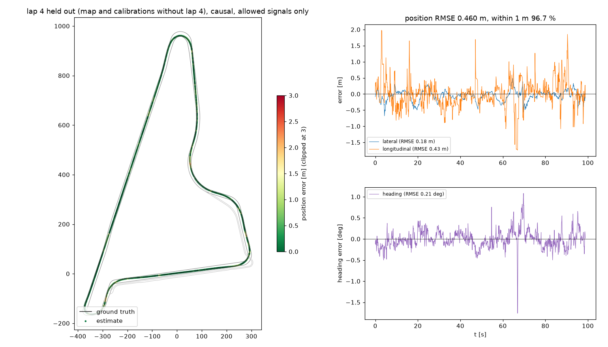

# yas-camloc: camera-based localisation on the Yas Marina track

Constructor Labs challenge, National AI Hackathon 2026. A causal localiser estimates the race car's 2D pose
(`x, y, yaw` of `constructor0/base_link` in `map`) at camera rate from its 7 cameras. It runs on CPU in real time.

**Results:** see [Results](#results). The full analysis is in `REPORT.md`, and the experiment history is in
`experiments/experiment_log.md`.

## Run it

```bash
./run.sh <test.mcap | test_dir> <out.csv> [training.mcap] [-- extra camloc.run options]
```

- `run.sh` creates the Python 3.12 venv from `requirements.txt` if missing.
- It builds the training-derived visual map if missing. That needs the training bag; the map is derived from
  the dataset, so it is not committed.
- It then writes `out.csv` (`timestamp_ns,x,y,yaw`) and `out.run.json`, which holds the per-frame processing
  time and the hardware.
- If the test file has no `/tf` first pose, pass it: `./run.sh test.mcap out.csv -- --init x,y,yaw`.
- The fused car-state variant (ADR-0003, not the default) runs with
  `./run.sh test.mcap out.csv -- --estimator vismap_est --state ambiguous`.

## Method (all causal: the pose at t uses only data stamped ≤ t)

```
 wheel speeds + steering ──► odometry (anti-slip axle choice, bicycle + understeer + steering lag)
                                   │ predict
 fl / fr / r images ──► keyframe rotation (LK + essential matrix) ──► relative-yaw update ─┐
                   └──► ORB vs geo-referenced 3D map ──► PnP + RANSAC ──► absolute pose fix ─┼─► EKF [x, y, yaw, yaw_kf]
 track borders (map) ──► lane model: track / pit lane, speed-gated switching; ────────────────┘
                         heading + lateral priors on straights when no map fix for > 2 s
```

1. **Odometry from allowed car signals only.**
   - Wheel speeds and steering, with parameters fitted on the training run (`tools/calibrate_odometry.py`).
   - The fused `state_estimation` speed and yaw-rate fields are **not used** by default. Their status is an
     open rules question; see `REPORT.md` §5.
2. **Visual heading.**
   - The rotation since a keyframe at most 1.5 s old is measured in `fl`, `fr` and `r` and fused through a
     cloned heading state.
   - Per-camera rotation scale (`fr` under-reports by 7.5 %), with a two-camera consensus.
3. **Map-based absolute fixes** (images contrast-normalised with CLAHE at build and query time).
   - At training time, ORB features are triangulated with the GT camera poses into a 3D map
     (`tools/build_map.py`).
   - At run time, per-camera PnP + RANSAC, gated by cross-camera consensus and an NIS test that can recover
     if the filter itself is wrong.
4. **Track model.**
   - The surveyed borders give the track and pit-lane centrelines, with (s, n) projection that respects heading.
   - Lane membership is tracked and switches at the pit branch points only when the car is slow, at pit speed.
   - The 3D borders give the road z, roll and pitch.
5. **Camera self-calibration.**
   - Rotation corrections of 1° or less per camera, fitted on training GT (`tools/calibrate_cameras.py`).
   - Ego-body masks are hand-drawn polygons (`camloc/assets/body_polygons.json`).

**Declarations** (brief, "Minimal requirements"):
- Pre-trained models: **none**. External or public datasets: **none**.
- Sensors used at inference: the camera images (`fl`, `fr`, `r`), camera calibration and track borders.
- Car-state fields used at inference (allowed signals only, ADR-0003): wheel speeds `omega_w_*`, steering
  `delta_wheel_rad`, and `valid_wheelsspeeds_b`. The fused `state_estimation` speed and yaw rate are **not**
  used by the default. Pose fields and anything derived from the pose (`x/y/z`, attitude, `sn_map_state`)
  are never read.
- The training run's GT is used only at training time (odometry, camera and road calibration, the visual
  map), for scoring, and for the first pose. The test
`tests/test_smoke.py::test_inference_modules_do_not_import_groundtruth` enforces that inference code never
imports the GT modules.

## Results

All numbers come from the training run with a **strict hold-out**: for each lap the visual map **and** the
odometry calibration are rebuilt **without that lap**, the localiser runs causally over the whole recording using only the allowed car signals,
and only the held-out lap is scored with the official metric (`camloc/evaluate.py`, which reproduces the
organiser's `tools/evaluate.py`).

| held-out lap | position RMSE | lateral | longitudinal | heading RMSE | p95 | within 1 m |
|---|---|---|---|---|---|---|
| 2 | 0.598 m | 0.404 m | 0.440 m | 0.40° | 1.09 m | 93.2 % |
| 4 | 0.460 m | 0.175 m | 0.426 m | 0.21° | 0.91 m | 96.7 % |
| 6 | 0.415 m | 0.206 m | 0.361 m | 0.19° | 0.86 m | 96.6 % |
| **pooled (3 laps)** | **0.513 m** | **0.303 m** | | **0.31°** | | **95.1 %** |

The organiser scoring-script output for each lap is in `submissions/validation/`.

- **Calibration leakage.** With the odometry fitted on the full run instead, the same pipeline scores
  0.509 m pooled. An earlier check refitted every calibration (camera rotations and rotation scales too)
  without lap 4 and found about 0.02 m of leakage (`tools/holdout.py`).
- **Fused car-state variant** (ADR-0003; measured before the sideslip default): pooled 0.639 m, lateral 0.430 m, 87.2 % within 1 m.



- **Pit lane:** 1.09 m (whole run, map without lap 6).
- **Organiser (s, n) scorer:** agrees with the x/y numbers within 1 %. GT (s, n) is re-projected onto
  `map.mcap`, because the training bag's `sn_map_state` does not match it (`REPORT.md` §11).
- **Speed:** 20.6 ms per frame mean, 28.4 ms p95, on an Apple M4 CPU, no GPU (input at 10 Hz; measured from a fresh clone, EXP-0024). The full 20-minute
  run takes about 5 minutes.

How we got here (whole run, allowed signals only; `experiments/experiment_log.md`):

| step | position RMSE |
|---|---|
| hold first pose | 528 m |
| + wheel / steering odometry | 144 m |
| + map priors on straights | 55.1 m |
| + visual heading | 21.5 m |
| + map-based PnP fixes | ≈1 m |
| + NIS gate, pit lane in map, lower single-camera threshold | 0.81 m held out |
| + contrast-normalised (CLAHE) map | 0.78 m held out |
| + single-camera threshold back to 30 with CLAHE, fix-quality weighting | 0.630 m held out |
| + sideslip (half gain) in the motion model | 0.586 m held out |
| + online sideslip states, phase-based axle choice (strict hold-out) | **0.513 m held out** |

### Robustness (the test may differ from the night training run)

**Image changes.** Query images were altered on held-out lap 4 (`tools/vmap_check.py --aug`); the map is
built from the unchanged night images. Columns give the `fr` map-localisation success rate:

| query images | plain ORB map | CLAHE-normalised map (default) |
|---|---|---|
| unchanged | 60 % | 82 % |
| darker (gamma 2) | 42 % | 72 % |
| contrast halved | 22 % | 66 % |
| washed out ("day": gamma 0.4, contrast 0.6) | 20 % | 60 % |
| 9 px motion blur | 11 % | 43 % |

When a fix succeeds it stays accurate: median 0.4–0.5 m in every case.

**Losing map fixes.** These are switches for testing only (`--set FIX_DROP=…` / `FIX_GAP_S=… FIX_PERIOD_S=…`):

| map fixes | lap 4 | whole run |
|---|---|---|
| all (final default) | 0.61 m | 0.81 m |
| 50 % dropped at random (earlier default) | 0.70 m | 0.97 m |
| 90 % dropped at random (earlier default) | 0.88 m | 2.34 m |
| none for 30 s of every 60 s (final default) | 2.32 m | 2.90 m |
| none for 60 s of every 120 s (final default) | 2.95 m | 4.73 m |

The filter recovers as soon as fixes return. Only a total, permanent map failure would fall back to the
visual-heading-only result (21.5 m).

**Known failure cases and limits**:
- **Back straight** (around x ≈ −300, y ≈ 0–250): feature-poor at night. With the plain map, lap 2 drifted
  2–5 m sideways there. The CLAHE map with the final settings removes that drift (`docs/traj_lap2_heldout.png`).
- **Sideslip.** The car's travel direction leads its heading by roughly 0.23° + 0.14° per m/s² of lateral
  acceleration. Ignoring it biased the estimate about 0.2 m outward, mostly in left turns. The EKF now learns
  two sideslip terms online from the map fixes (EXP-0026), with no GT-fitted gain.
- **Locked front wheels under hard braking.** The front wheels can lock while the car is still at 20 m/s. An
  odometry that trusted the front axle then ran away by 16 m in the lap 2 hairpin (EXP-0028). The axle is now
  chosen by driving phase: under braking the faster axle, otherwise the front axle, times cos(steer).
- **No lateral measurement from paint or kerbs:** with cameras about 0.2 m above the border paint it is
  geometrically unobservable (EXP-0006). A real daylight recording has not been tested; the augmentations above
are only a proxy for it.

## Repository

| path | content |
|---|---|
| `camloc/` | the localiser: `data.py` (causal replay), `track.py`, `odometry.py`, `filter.py`, `vision_rot.py`, `vmap.py`, `road.py`, `geometry.py`, `run.py` |
| `camloc/tools/` | training-time calibration, map building and diagnostics (these may use GT) |
| `camloc/evaluate.py` | scoring harness: the official metric (verified equal to `tools/evaluate.py`) plus breakdowns by sector, speed, lane, lap and GT quality, and the organiser (s, n) scorer via `--sn` |
| `analysis/`, `REPORT.md` | dataset analysis and the decisions behind the design |
| `docs/` | trajectory plots of validation laps |
| `tests/` | `pytest -q tests` |

Agent and team workflow files: `CLAUDE.md`, `STATE.md`, `worklog.md`, `AGENTS.md`, `GOVERNANCE.md`.
