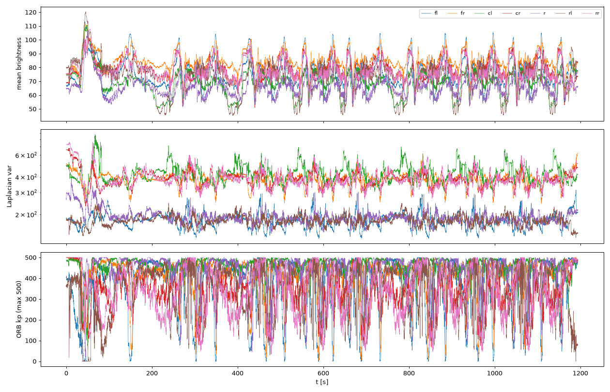
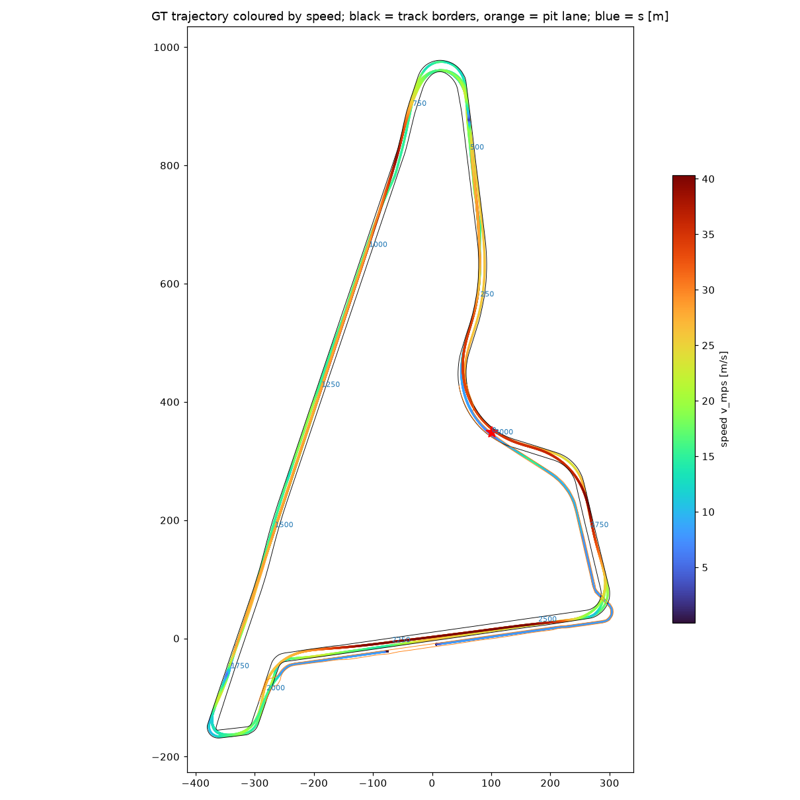
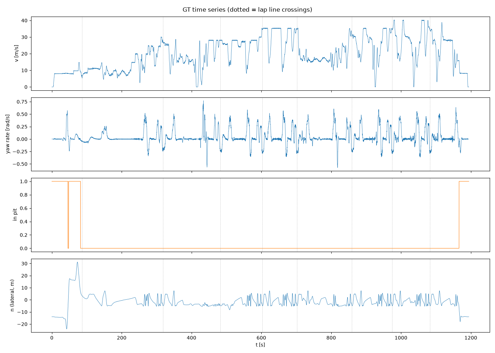
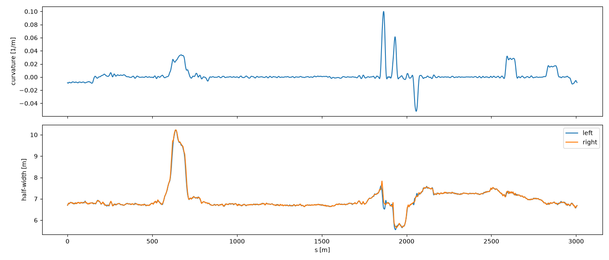
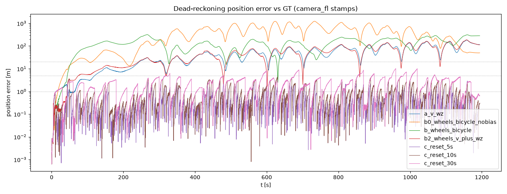
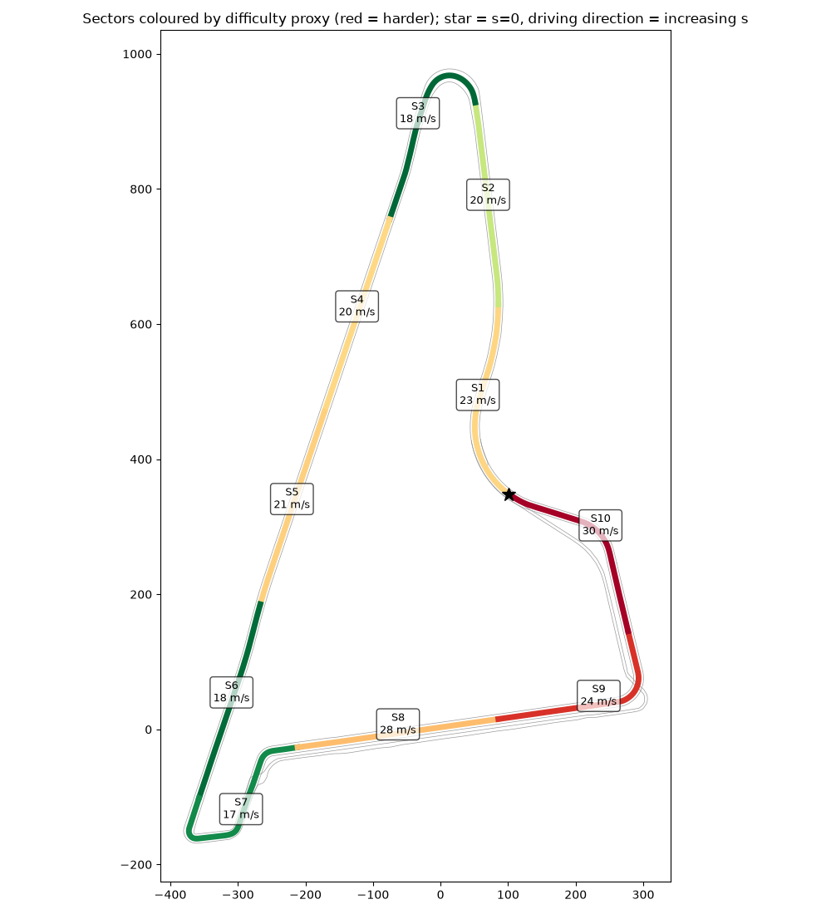

# Yas Marina camera-only localization: dataset analysis

Dataset: `c0_2026-10-13_22-53-42_camloc` (training run, night, 1194 s). This is analysis only, with no localization system yet.
Machine: Apple M4, 16 GB RAM, macOS 26.5.2, 213 GB free. Python 3.12 venv (`.venv`, versions in `requirements.txt`).
Every number below was measured on this one run. Its scope is stated with it. Nothing here is an "overall accuracy" of any method.

---

## Executive summary (1 page)

**What the data is.**
- 7 cameras at 10.000 Hz, 1506×728 JPEG. They are hardware-synchronised: all cameras share the `fl` stamp to within 0.01 ms. `camera_r` dropped 5 frames; no other camera dropped any.
- Track map: surveyed left/right borders plus pit-lane borders. The README calls the layout Yas Marina **North**. The centreline we built is **3006 m**, with a median width of **13.6 m**.
- GT at 106 Hz, with no gap over 50 ms (max 37.8 ms), so the evaluator never skips a sample.
- The car runs out of the pit lane, covers **7 full laps** (fastest **98.9 s**) plus out- and in-laps, and returns to the pit. Distance is 23.8 km.
- Speed: max **40.6 m/s** (146 km/h), mean 19.9, p95 35.4 m/s. Max |yaw rate| is 0.77 rad/s.
- **9.0 % of the time is in the pit lane**: the first 82 s and the last 28 s. The hidden test also starts from a given first pose, which is probably in the pit as well.

**Five findings that change the plan:**
1. **The rules conflict is real, and the "car-state" fields are not raw sensors.**
   - `wz_radps` matches the GT yaw rate to 0.0035 rad/s RMS, although `valid_imu_b` is always false.
   - `v_mps` is the estimator's fused speed (= `vx_mps`).
   - `yaw_vel_rad` is *exactly* `yaw_rad + beta_rad`, and `sn_map_state` is computed from the pose.
   - Only wheel speeds, steering, throttle/brake/rpm/gear and brake pressures are clearly raw.
   - See the allowed / ambiguous / forbidden table (§4). **Ask the organisers before relying on `v_mps`/`wz_radps`.**
2. **Dead reckoning alone is hopeless, and the allowed-only version is much worse.**
   - (a) `v_mps` + `wz_radps`: position RMSE **65.5 m**, lateral 50.5 m, 2.5 % of poses within 1 m. 1 m error is first exceeded at **12.6 s**. This confirms the reference figures (≈65 m, ≈15 s, ≈3 %).
   - (b) wheel speeds + steering through a bicycle model (radius 0.307 m, wheelbase 3.83 m and a 0.07° steering offset, all fitted on GT): **154 m**. Its yaw-rate error (0.018 rad/s RMS) is 5× worse than the `wz_radps` field.
   - (c) diagnostic, re-initialised from GT every 5 / 10 / 30 s: **0.64 / 1.14 / 2.87 m** RMSE. Even perfect absolute fixes every 5 s only reach 89 % within 1 m. **Vision has to correct every frame, not occasionally.**
3. **73 % of the centreline is near-straight** (radius > 500 m). Matching curvature or yaw rate pins the longitudinal position *s* only in corners (S3, S7, S9/S10). On the long straights S4/S5 (≈600 m, up to 40 m/s), *s* must come from landmarks such as gantries, light poles, LED boards, grandstands and the Yas control tower, or it drifts with wheel slip (wheel-speed error 0.48 m/s RMS).
4. **The calibration is uneven and matters for lateral error.**
   - 1° of yaw error costs 0.17 / 0.52 / 1.05 m at 10 / 30 / 60 m.
   - `cl`/`cr` keep an old calibration, and their mounts are asymmetric (view yaw +65.8° / −56.2°).
   - `rl`/`rr` use different lenses (fx 1514 vs 832).
   - Four cameras have fy/fx ≈ 0.86–0.87, a sign of anisotropic image scaling.
   - Roll and translation are uncalibrated. Use near-range cues (< 15 m) for lateral updates, and self-calibrate extrinsics on the training GT.
5. **The GT is not uniformly 0.1 m.**
   - `pos_accuracy` reaches **355 m** at 42.6–54.8 s, in the pit lane.
   - There are recurring 1–2 s blips of 2–4.6 m at s ≈ 320–360, 960–1000, 1540–1590, 2280–2390, 2620 and 2840–2880 m. These are probably GNSS shadows under the bridges and grandstands.
   - Exclude or down-weight these spans when validating and when fitting.

**Recommendation in one line.** Keep the user's hypothesis: a causal filter in track coordinates (s, n, heading error), predicted from wheel odometry and steering (plus `wz`/`v` only if allowed). Two corrections:
- Lateral and heading updates **every frame** from border lines seen by `cl`/`cr`/`rl`/`rr`.
- Longitudinal updates from geometric landmarks, not appearance, because the test may be in daylight. Model the pit lane as its own topology.

Details and the first-week plan are in §8.

---

## 0. Setup and sources

- `requirements.txt` pins: mcap 1.5.0, mcap-ros2-support 0.5.7, numpy 2.5.4, scipy 1.18.1, opencv-python 5.0.0.93, matplotlib 3.11.2, pandas 3.0.6.
- The dataset ZIP downloaded in about 2 min (≈55 MB/s) and unzipped to `data/` (7.0 GiB). `data/` is git-ignored, as the licence requires.
- I read `README.md`, `tools/extract_gt.py` and `tools/evaluate.py` in full.

**Differences from the prompt and PDF:**

| Item | Prompt / PDF | What the data / README says |
|---|---|---|
| Car-state data | PDF: "accelerations, speed, and other fields can be used" | README: `/tf` **and** `/constructor0/state_estimation` are "the ground truth … not as an input of the method". This is a direct conflict (Q1 for organisers). |
| Layout | "which layout?" | README: "Yas Marina **North**". Measured centreline is 3006 m (borders 2958 / 3057 m). |
| Score | 5 weighted metrics | `evaluate.py` prints position RMSE as "the score". Lateral, yaw and within-1 m are printed too. Runtime is self-reported. |
| GT accuracy | ≈0.1 m / 0.2° | `pos_accuracy` field: > 1 m for 3.0 % of the time, up to 355 m (§2). |
| `track_bounds_check.png` | Listed in the README file table | **Not in the ZIP.** |
| IMU | "no IMU data" | Correct for raw IMU. `valid_imu_b` is always false, yet the angular-rate and acceleration fields are populated, so they come from the estimator. |
| Other traffic | Not mentioned | **Other cars are on track** (visible in `fl`/`fr`, e.g. S4 montage). These are dynamic occluders. |
| Evaluator coverage | ≥ 90 % of 1 s bins | Bins run from the first to the last **GT** stamp. A pose with no GT within 50 ms is skipped. |

`dump_meta.py` reproduces `tools/extract_gt.py` exactly: 126,680 poses, maximum difference 0 on every column.

---

## 1. Inventory

| Topic | Type | Count | Rate |
|---|---|---|---|
| `camera_{fl,fr,cl,cr,rl,rr}/compressed_image` | CompressedImage | 11,944 each | 10.000 Hz |
| `camera_r/compressed_image` | CompressedImage | 11,939 | 9.996 Hz (5 drops) |
| `camera_*/camera_info` | CameraInfo | 1,195 each | 1 Hz, **never changes** |
| `/tf` | TFMessage | 126,680 | 106.06 Hz (GT) |
| `/constructor0/state_estimation` | StateEstimation | 126,574 | 105.97 Hz (85 numeric fields) |
| `/tf_static` | TFMessage | 120 | 0.1 Hz |
| `/constructor0/track_bounds` | MarkerArray | 120 | 0.1 Hz |

- `track_left` has 5,914 points and `track_right` 6,115, both closed loops at 0.5 m spacing.
- `pitlane_left`/`pitlane_right` have 2,260 / 2,243 points (≈1.12 km, open).
- `/tf_static` also lists lidar, radar, GNSS and IMU frames. Only the camera frames matter here.

## 2. Cameras (step 2.1)

| cam | fx / fy | HFOV | view yaw / pitch-down | mount x, y, z [m] | k1, k2 | frames, drops | median JPEG |
|---|---|---|---|---|---|---|---|
| fl | 2601 / 2590 | 32° | +4.8° / 2.2° | 0.94, 0.20, 0.34 | −0.39, 0.12 | 11944, 0 | 115 kB |
| fr | 1350 / 1166 | 58° | −5.9° / 1.6° | 0.95, −0.16, 0.34 | −0.40, 0.20 | 11944, 0 | 58 kB |
| cl | 797 / 692 | 87° | +65.8° / −1.2° | 0.47, 0.25, 0.35 | −0.30, 0.07 | 11944, 0 | 71 kB |
| cr | 744 / 644 | 91° | −56.2° / 3.1° | 0.47, −0.25, 0.35 | −0.30, 0.08 | 11944, 0 | 68 kB |
| r | 1491 / 1492 | 54° | −178.1° / −0.3° | −2.28, 0.00, 0.07 | −0.34, 0.13 | 11939, **5** | 127 kB |
| rl | 1514 / 1514 | 53° | +119.1° / −0.7° | 0.15, 0.12, 0.42 | −0.34, 0.15 | 11944, 0 | 120 kB |
| rr | 832 / 722 | 84° | −117.5° / −1.9° | 0.15, −0.12, 0.42 | −0.24, 0.04 | 11944, 0 | 66 kB |

View yaw and pitch are the direction of the optical axis in `base_link`, computed from `/tf_static`.

- **Timing.**
  - Frame period: median 100.0 ms on every camera. Max gap is 100 ms except `r` (204 ms: 5 single-frame drops).
  - Sync against `fl`: median |Δ| 0.01 ms, max 4.2 ms (`r` only). The cameras are effectively triggered together, so one pose per image set works.
  - Header-to-log latency: median **42 ms**, max 85–99 ms. This is the transport delay a real-time system would also see.
- **Brightness** (mean grey level 0–255, p5/p50/p95):
  - fl 61/74/99, fr 75/84/97, cl 53/69/80, cr 66/78/92, r 56/65/81, rl 49/76/86, rr 67/77/92.
  - The images are dim, low-contrast and hazy. `fl` is the softest: lowest Laplacian variance (median 178), and its image looks fogged (lens haze or dirt?).
- **Sharpness.**
  - Laplacian variance at 1/2 resolution, median: fl 178, fr 386, cl 420, cr 383, r 187, rl 178, rr 375.
  - It barely differs between slow (< 15 m/s) and fast (> 30 m/s) frames, e.g. cl 398 vs 413. **This measure is dominated by night sensor noise and is not a usable blur indicator.**
  - Exposure time is not in the data, so blur at 40 m/s can't be quantified from metadata. Visually, near-field asphalt and kerbs smear in `cl`/`cr`/`rr` at speed.
- **Ego-body regions to mask**, read from the per-pixel mean image (`analysis/body_mask.png`). An automatic low-temporal-std threshold was tried and is **unreliable at night**: dark road also has low variance. Use the manual polygons below.
  - `fr`: nose cone (orange with a white circle) plus the front-right tyre fill the bottom ≈40 % and the right edge.
  - `cl`/`cr`: front wing, tyre and suspension fill the bottom ≈45 %.
  - `rr`: rear bodywork fills the bottom ≈25 %, plus the rear tyre at the right.
  - `fl`: a small strip of nose at the bottom right (≈10 %).
  - `r` and `rl`: no body visible.
- **Calibration caveats (README).**
  - Pitch is reliable on all cameras. Yaw is reliable on `r` and `rl`, ±1° on `fl`/`fr`. `cl`/`cr` keep the previous calibration.
  - Roll and translation are mount values, not calibrated.
  - 1° of yaw error displaces a point by **0.17 m at 10 m, 0.52 m at 30 m and 1.05 m at 60 m**.
  - Also: four cameras have fy/fx ≈ 0.86–0.87 (fr, cl, cr, rr) while three have fy ≈ fx. This suggests intrinsics from a differently scaled image. Verify with a reprojection check before trusting ground-plane projection (Q for organisers).

## 3. Ground truth (step 2.2)

| Quantity | Value |
|---|---|
| Duration / samples / rate | 1194.4 s / 126,680 / 106.06 Hz |
| Δt median / max | 9.52 ms / 37.8 ms. **0 gaps > 50 ms**, so the evaluator never skips. |
| Speed max / mean / p95 | 40.6 / 19.9 / 35.4 m/s. `v_mps` field max is 40.3; GT-differentiated vs `v_mps` RMSE 0.14 m/s. |
| |yaw rate| max / p99 | 0.77 / 0.51 rad/s |
| Distance | 23.8 km. Stationary 16 s in total. |
| Laps | Crossings of s = 0 (on track) at 86.3, 318.2, 482.6, 602.8, 701.7, 859.5, 974.5, 1083.0 s. This gives **7 full laps**: 231.9, 164.5, 120.2, **98.9**, 157.8, 115.0, 108.4 s, plus a pit out-lap (0–86 s) and an in-lap (1083–1194 s). |
| Pit lane | 0–82 s (start in pit, exit) and 1166–1194 s (entry, stop). **9.0 % of the time.** One pit exit and one pit entry. |
| GT quality | `pos_accuracy` (horizontal) > 0.5 / 1 / 2 / 5 m for 4.5 / 3.0 / 2.1 / 1.0 % of the time. Worst span: **42.6–54.8 s, up to 355 m** (pit lane). The GT trajectory itself has no jumps (max step speed 44.9 m/s), so the GT is probably coasting there and is untrustworthy. |
| First pose | x 7.173, y −9.909, yaw 0.1263 rad (in the pit lane, stationary) |

Speed is not a race-pace profile on every lap. Laps 1, 2 and 5 contain long slow stretches (10–20 m/s), so the "lap time" spread reflects the driving programme, not difficulty.

## 4. Track map (step 2.3)

- **Length**: centreline 3006 m. I built it from the midpoints between the borders, smoothed and resampled at 1 m. The left and right borders measure 2958 and 3057 m.
- **Width**: p0 / p5 / p50 / p95 / p100 = 11.2 / 13.3 / **13.6** / 15.0 / 20.4 m. The left and right half-widths are symmetric (median 6.79 m each).
- **Curvature**: minimum radius ≈ 10 m on the centreline at the bottom-left hairpin (x −370, y −159, s ≈ 1864 m). Smoothing may understate the radius slightly. |κ| p99 is 0.052 /m. **72.6 % of the centreline has radius > 500 m.**
- **Racing line vs centreline**: |n| p95 on track is 5.2 m; |heading − centreline heading| p95 is 15°. The car uses the full width, so a centreline-only prior is not a good pose estimate.
- **Pit lane**: runs parallel to and south of the main straight. It extends round the eastern corner and up the inside to merge near s ≈ 0. Its borders are 0–10 m from the nearest track border (median 5.1 m left, 9.7 m right; they touch at the merges), so lateral ambiguity between track and pit is a real failure mode.

## 5. Car-state fields (step 2.4)

The audit is in `analysis/fields.py`, with full ranges and update rates in `analysis/out/fields.json`. The evidence column gives measured identities.

| Class | Fields | Evidence / reasoning |
|---|---|---|
| **Forbidden** (GT pose, or computed from it) | `x_m, y_m, z_m, yaw_rad` | Identical to `/tf` GT (RMS 2e-6 m, 6e-6°). |
| | `roll_rad, pitch_rad` | Estimator attitude (19.5 Hz). Part of the GT state. |
| | `yaw_vel_rad` | **Exactly** `yaw_rad + beta_rad` (RMS 6e-16°), so it contains the GT heading. |
| | `sn_map_state.*` (s idx, ds, n, dist_to_border, is_inside_borders, current_lane) | Track coordinates of the GT pose. Using them would be using the GT. |
| | `pos_accuracy[*]`, `se_status`, `se_state` | Estimator health. They leak GNSS availability; no use as input. |
| **Ambiguous** (fused estimator outputs; PDF says allowed, README says GT) | `v_mps`, `vx_mps`, `vy_mps`, `beta_rad`, `dbeta_radps` | `v_mps` = `vx_mps` (RMS 0.003 m/s). `beta` = atan(vy/vx) exactly. Velocity is an output of the GNSS/lidar-aided filter, not of a sensor. |
| | `wz_radps`, `wx_radps`, `wy_radps` | `wz` matches d(yaw_GT)/dt to **0.0035 rad/s RMS** while `valid_imu_b` is always false, so it is the filtered estimator rate. It is very good: (a) beats (b) by 2.4×. |
| | `ax/ay/az_mps2`, `ax_vel/ay_vel_mps2` | Estimator accelerations. `ay` ≈ v·wz (RMS 0.31 m/s²). |
| | `kappa_radpm` | = `wz/v` (RMS 1e-5). Derived from the two fields above. |
| | `alpha_*_rad` (tyre slip angles), `diff_fr_alpha_rad`, `lambda_*_perc` (slip ratios) | Model outputs that need the estimator's velocity as reference. |
| | `v_raw_mps` | 102.5 Hz. Differs from `v_mps` by 0.28 m/s RMS. Probably a raw speed (wheel/Kistler?), but the source is undocumented. Ask. |
| **Allowed** (raw vehicle signals, independent of pose) | `omega_w_fl/fr/rl/rr` | Wheel speeds, ~100 Hz. ×0.307 m gives speed within 0.48 m/s RMS of GT (slip). |
| | `delta_wheel_rad` | Steering, 16.5 Hz. Fitted bicycle wheelbase 3.83 m, offset 0.07°. |
| | `gas, brake, rpm, gear, cba_actual_pressure_*` | Driver/actuator signals. Useful as priors for acceleration and braking. |
| | `valid_wheelsspeeds_b`, `timestamp` | Wheel-speed validity flag (true 99.6 %). The timestamp equals the header stamp. |
| **Constant / invalid (useless)** | `vel_accuracy[*]`, `vz_mps`, `valid_imu_b` (always false), `ddyaw_radps2`, `clutch`, `front/rear_brake_pressure`, `vehicle_timestamp`, `residuals_status`, `std_dev_status`, `is_safe`, `sn…epsi` (always 0), `sn…status` | Constant over the whole run. |

## 6. Dead-reckoning baselines (step 2.5)

All runs are causal: integrated at the state-estimation rate using only samples stamped ≤ t, and emitted at every `camera_fl` stamp (11,944 poses, coverage 100 %). Only the first GT pose is used, except (c). Scored with `tools/evaluate.py` on the **whole run, pit lane included**.

| Run | Inputs | pos RMSE | lat RMSE | lon RMSE | yaw RMSE | ≤ 1 m | 1 m first exceeded | 5 m | 20 m |
|---|---|---|---|---|---|---|---|---|---|
| (a) | `v_mps` + `wz_radps` *(ambiguous)* | **65.5 m** | 50.5 | 41.7 | 8.65° | 2.5 % | **12.6 s** | 120 s | 244 s |
| (b) | wheel ω·r + bicycle(δ) *(allowed)* | 154.3 m | 114.0 | 103.9 | 13.7° | 2.3 % | 27.0 s | 43.8 s | 55.2 s |
| (b0) | same as (b) without the steering-offset fit | 496.9 m | 332.1 | 369.7 | 91.7° | 1.4 % | 17.4 s | 32.0 s | 63.9 s |
| (b2) | wheel ω·r + `wz_radps` | 68.5 m | 52.5 | 44.1 | 8.65° | 3.6 % | 43.3 s | 74.8 s | 242 s |
| (c) N = 5 s | (a) reset from GT every 5 s *(diagnostic, uses GT)* | 0.64 m | 0.47 | 0.43 | 0.17° | 89.2 % | — | never | never |
| (c) N = 10 s | ditto, every 10 s | 1.14 m | 0.70 | 0.90 | 0.26° | 72.5 % | — | never | never |
| (c) N = 30 s | ditto, every 30 s | 2.87 m | 1.99 | 2.07 | 0.37° | 31.4 % | 12.6 s | 327 s | never |

**Reference check.** (a) gave 65.5 m RMSE, first exceeded 1 m at 12.6 s, and had 2.5 % of poses within 1 m. This confirms the earlier run (≈65 m, ≈15 s, 3 %); the 1 m time is a little earlier than quoted.

**Readings:**
- Heading drives the error. `wz_radps` has a bias of only −2.4e-4 rad/s, but that integrates to ≈16° over the run.
- In (b) the bicycle yaw rate is 5× noisier (0.018 rad/s RMS). With the 0.07° steering offset left unfitted (b0) it diverges completely.
- (c) is an *upper bound* on what intermittent absolute fixes alone can buy. Even with perfect fixes every 5 s, lateral RMSE is 0.47 m. The 5 s and 10 s runs first exceed 1 m at 43 s, inside the degraded-GT pit span, which is a GT artifact, not drift.

## 7. Visual conditions (step 2.6)

Montages: `analysis/montage_{60,330,600,900}s.png` and, at sector midpoints on the fastest lap, `analysis/montage_S{2,4,7,9,10}.png`.

| Camera | Usable cues | Problems |
|---|---|---|
| `fl` (32°, forward) | Far-field: the track vanishing direction, gantries/bridges, the Yas control tower (lattice tower on the pit straight), light-pole rows, cars ahead | Hazy/low contrast throughout, as if fogged; lowest sharpness. Narrow FOV means 1° of yaw error costs 1 m at 60 m. Other cars ahead occlude. |
| `fr` (58°, forward) | Track edges and lines ahead, catch-fence posts, kerb ahead | Lower ≈40 % is the car nose and tyre. Glare from floodlights. |
| `cl` / `cr` (87–91°, front-side) | **Best for lateral/heading**: the white edge line plus blue run-off paint at 3–15 m, kerbs, barrier base, light-pole rows, grandstands | Bottom ≈45 % is wing and tyre. Lens flare from floodlights. Old calibration (yaw not refreshed). Near-field asphalt blurs at speed. |
| `rl` (53°, rear-left) | Grandstands, LED boards (A2RL), barrier/fence lines, edge lines behind | Strong flare from the poles. Low texture on the run-off. |
| `rr` (84°, rear-right) | Edge lines, barrier, grandstands, pit buildings | Bottom ≈25 % is bodywork. |
| `r` (54°, rear) | Bridges/gantries behind (e.g. "Etihad" and "Castore" bridges are clearly legible), track vanishing line | 5 dropped frames. Rear view gives information delayed in s. |

**Problems across all cameras:**
- Haze and floodlight glare/flare, and a dark sky.
- Low-texture asphalt.
- Highly repetitive catch fencing, Armco and light-pole rows, which cause aliasing for any feature or landmark matcher.
- Long straights with few distinct structures (S4/S5).
- Other cars.

**What should survive daylight:**
- Painted lines (white edge plus blue run-off), kerbs.
- Barrier and fence geometry.
- Bridges/gantries, grandstands, the Yas tower.
- Pole *structures* (vertical lines), track-edge geometry.

**What is likely night-only:**
- Floodlight blobs and their flare (the most salient feature at night, so the most dangerous to depend on).
- Illuminated LED boards.
- The current exposure and haze characteristics. Daylight adds hard shadows from the grandstands and bridges, which will create false edges.

## 8. Sector difficulty (step 2.7)

There are 10 equal sectors of 300.6 m along the centreline, driving direction = increasing s, with s = 0 at the star in `analysis/sectors.png`. Only on-track `fl` frames are used (pit excluded).

The visual proxies are medians:
- *ORB-W*: ORB keypoints in the wide `cl`/`cr` cameras (max 500, ½ resolution).
- *edge-W*: lower-half Canny density in `cl`/`cr`.
- *ORB-fl*: the same keypoint count for `fl`.

*GT blip* = frames with `pos_accuracy` > 1 m. The *Difficulty* score is z(speed) + z(straight share) − z(ORB-W) − z(edge-W). It is a rough proxy, not a validated predictor.

| Sector | s [m] | frames | v mean / max [m/s] | min radius [m] | straight share | ORB-W | edge-W | ORB-fl | GT blip | Difficulty |
|---|---|---|---|---|---|---|---|---|---|---|
| S1 | 0–301 | 1009 | 23.4 / 40.3 | 106 | 25 % | 375 | 0.025 | 423 | 0 | +0.69 |
| S2 | 301–601 | 1206 | 19.9 / 35.5 | 181 | 81 % | 425 | 0.033 | 390 | 48 | −0.66 |
| S3 | 601–902 | 1323 | 17.7 / 40.2 | 30 | 45 % | 428 | 0.033 | 397 | 0 | −2.61 |
| S4 | 902–1203 | 1195 | 20.1 / 40.2 | 576 | **100 %** | 405 | 0.033 | 480 | 53 | +0.68 |
| S5 | 1203–1503 | 1129 | 21.2 / 35.4 | 677 | **100 %** | 383 | 0.037 | 442 | 0 | +0.78 |
| S6 | 1503–1804 | 1348 | 17.8 / 35.4 | 343 | 95 % | 400 | 0.048 | 418 | 46 | −2.57 |
| S7 | 1804–2104 | 1313 | 17.3 / 28.6 | **10** (hairpin) | 47 % | 432 | 0.030 | 326 | 0 | −2.22 |
| S8 | 2104–2405 | 750 | 28.0 / 40.2 | 315 | 96 % | 482 | 0.031 | 483 | 67 | +0.98 |
| S9 | 2405–2706 | 883 | 23.8 / 40.2 | 31 | 76 % | 345 | 0.032 | **92** | 20 | **+2.19** |
| S10 | 2706–3006 | 707 | **29.9** / 40.0 | 58 | 62 % | **334** | 0.036 | 361 | 22 | **+2.74** |

**Hardest sectors:**
- **S10 and S9.** These are the fastest sectors, the pit straight and the approach to s = 0. They have the fewest wide-camera features, `fl` almost blind in S9 (92 keypoints, haze plus featureless grandstand facades), and **pit entry/exit run alongside**.
- **S4/S5 and S8.** These are 100 % / 96 % straight at up to 40 m/s, so there is no curvature signal for s, and S4/S8 also have GT blips.
- **S7** (10 m hairpin) is slow and feature-rich, but it has the highest yaw rate. That makes it a good place for *heading* fixes and a risky one for latency.

## 9. Recommendation (no implementation)

### The hypothesis, point by point

| Hypothesis | Verdict | Evidence |
|---|---|---|
| Causal EKF/PF in track coordinates (s, n, heading error) | **Confirm**, with two changes. (1) Add the pit lane as a second "lane" (own centreline, with branch points at entry and exit). The car spends 9 % of the time there, starts there, and the pit-lane borders run 0–10 m from the track borders. (2) Start with a particle filter, or an EKF plus a small multi-hypothesis bank, near repeated structures. | §3, §4 |
| Prediction from speed + yaw rate if allowed, otherwise VO | **Refine.** Use wheel speeds (r = 0.307 m) plus steering (bicycle model, L = 3.83 m, fitted offset) as the always-legal base; it is 154 m standalone. Add `wz_radps`/`v_mps` only if the organisers confirm they are allowed (65 m standalone). Rotation-only VO from `cl`/`cr` (far features, rotation is well conditioned) is the legal way to recover the 5× better yaw rate. | §5, §6 |
| Lateral + heading update from edges/kerbs/lines projected to the ground and matched to the borders | **Confirm, as the main signal, every frame.** (c) shows that even perfect fixes every 5 s leave 0.47 m lateral RMSE, so a correction is needed at 10 Hz. Use `cl`/`cr`/`rl`/`rr` at < 15 m range (1° yaw error costs only ≤ 0.26 m). Mask ego-body polygons and other cars. | §2, §6 |
| Longitudinal update from curvature/yaw-rate matching to the map | **Partially challenge.** Only ≈27 % of the lap has radius < 500 m. It works in S3/S7/S9/S10 corners and is useless on S4/S5/S8. | §4, §8 |
| Geotagged keyframes from training laps | **Challenge as the primary s-source.** The training data is night-only, the test may be daylight, and floodlight blobs dominate the night features. Use *geometric* landmarks instead: bridge/gantry crossings (`r`/`fl`), pole bases as vertical lines against a surveyed pole map built from training GT, and the start of kerbs. Keep keyframes as a night-only bonus. | §7 |
| Self-calibrate extrinsics from training GT | **Confirm, high priority.** `cl`/`cr` yaw is stale, roll and translation are uncalibrated, and fy/fx anisotropy needs explaining. Fit per-camera yaw/pitch/roll by aligning projected border lines to the map using the GT pose. | §2 |
| No VLMs or large models; real-time on one GPU or the M4 CPU | **Feasible.** Decoding all 7 JPEGs at ½ resolution plus ORB took 54 s wall for 11,944 frame sets on 7 processes (≈4.5 ms wall per set). That leaves most of the 100 ms budget for line detection plus a filter on CPU. | `dump_frames.py` timing |
| Validation by held-out laps; error by sector, speed, pit; lighting/blur augmentation | **Confirm, and add:** exclude GT spans with `pos_accuracy` > 1 m (§3); report the pit lane separately; hold out the fastest lap (lap 4, 602.8–701.7 s) because the test may be faster. | §3, §8 |

### First-week plan

| Day | Work |
|---|---|
| **D1** | Data loader with a causal replay clock (frames by header stamp). Track model: track and pit centrelines, (s, n) projection, branch points. Evaluation harness: `evaluate.py` plus per-sector, speed-bin and pit breakdown, with GT-blip masking. |
| **D2** | Wheel plus bicycle predictor in (s, n, ψ) with process noise tuned on training (EKF). Ego-body masks per camera. |
| **D3** | Line/edge detector for the white line plus blue run-off (colour + gradient, works at night and should transfer to day). Inverse-perspective mapping with the extrinsics. Extrinsic self-calibration from training GT. |
| **D4** | Lateral/heading update: chamfer distance of projected edge points to the border polylines, giving an EKF measurement. First full run. Report lateral RMSE by sector. |
| **D5** | Longitudinal: curvature matching in corners plus a landmark map (bridges, gantries, pole bases) built from training GT. Add a particle filter or multi-hypothesis for pit vs track and straights. |
| **D6** | Robustness: blur, brightness and gamma augmentation to simulate daylight; stress test on the fastest lap with frames dropped. Runtime profiling on the M4. |
| **D7** | Freeze. Single `run.sh` from the raw mcap to the CSV. README. Validation numbers. Trajectory-vs-GT video. Slides on failure cases. |

### Questions for the organisers

1. **Which `/constructor0/state_estimation` fields may be used at inference?** List specifically `v_mps`, `vx/vy`, `wz_radps`, `ax/ay`, `beta`, `kappa`, `v_raw_mps`, wheel speeds, `delta_wheel_rad`. The README says the whole topic is GT; the PDF says car state is allowed.
2. Does the hidden test run contain the `state_estimation` topic at all (minus pose fields), or only images, `camera_info`, `tf_static` and `track_bounds`?
3. Same layout (North) and the same track-bounds survey in the test?
4. Same car and camera calibration (intrinsics and extrinsics) in the test? Will `cl`/`cr` be recalibrated? Why do fr/cl/cr/rr have fy/fx ≈ 0.86?
5. Test lighting (day, dusk or night) and the speed range? Does it start in the pit lane and include pit passes?
6. Are other cars present in the test run?
7. How is runtime normalised (the hardware they will re-run on), and is the 42 ms transport latency counted?
8. Is the score computed over the whole run, including the pit lane and the low-accuracy GT spans, or only over "test laps"?
9. Is the exposure time available? The README says the stamp is "exposure time"; is that the start or the middle of the exposure?
10. Is `track_bounds_check.png` (listed in the README, missing from the ZIP) available?

---

## Reproduce

See `analysis/README.md`. All derived data goes to `analysis/out/` (git-ignored: it contains GT). Plots go to `analysis/*.png`.

---

## 10. Update after D3 (2026-10-17 06:35 CEST): what the camera geometry allows

Measured on the training run (EXP-0005 to EXP-0008). These change the plan in §9.

- **Lateral position from ground paint is geometrically unobservable with these camera mounts.**
  - The cameras sit about 0.35 m above base_link, and the surveyed border paint about 0.13 m above it. So the lens is only about 0.2 m above the line.
  - At 7 m to the side, the border is 1.5° below the horizon. A 0.5 m lateral move shifts it by about 1.3 px vertically (full resolution); mostly it slides *along* itself, which can't be observed.
  - Measured sensitivity is 0.1–1.7 px/m (half resolution) against 4–6 px per-frame residual noise. That is 3–40 m lateral-equivalent per camera-frame, and no use as a measurement.
  - The inverse-perspective / chamfer-to-borders idea (§9, D3/D4) is therefore dropped for lateral.
- **Camera self-calibration works and is kept.** Rotations were fitted on near-border residuals with the GT pose, with a 1° prior and a held-out gate:
  - Biases removed: `cr` +3.05 → +0.86 px, `fr` +4.65 → +1.13 px, `rr` +1.99 → +0.40 px.
  - Partly reduced: `fl` +5.38 → +2.15 px.
  - `rl` stays at nominal, which agrees with the README. The corrections are in `camloc/assets/camera_adjust.json`.
- **Road attitude comes from the map.**
  - Pitch is 0.99 × the road gradient (0.14° residual). Roll is 1.02 × the road bank (0.50° residual). The car's own body roll from lateral acceleration is negligible.
  - Implemented in `camloc/road.py` (no GT at inference).
- **Visual rotation is the well-conditioned camera signal.**
  - Frame-to-frame rotation from optical flow plus the essential matrix is unbiased (median about 0°, MAD 0.10–0.12° in `fl`/`fr`), but has outliers.
  - Heading is exactly what the allowed-only odometry lacks: it drifts about 2° per 10 s (EXP-0003). With a good yaw rate (the fused field, EXP-0004) the same filter reaches 13.8 m instead of 55 m.

**Revised D4/D5:**
1. Heading-bias correction from visual rotation against keyframes 1–2 s back (`fl`/`fr`/`r`; robust, gated), fused into the EKF. Target: close the 55 m → 14 m gap without the ambiguous fields.
2. Longitudinal *s* and absolute lateral from *structures with height*, whose angular size and position are well conditioned:
   - gantries and bridges, light poles, the barrier/fence top line;
   - a landmark map of these built from the training GT (allowed: training).
3. Keep the straights-only map priors (§EXP-0004) as the lateral and heading backbone.
